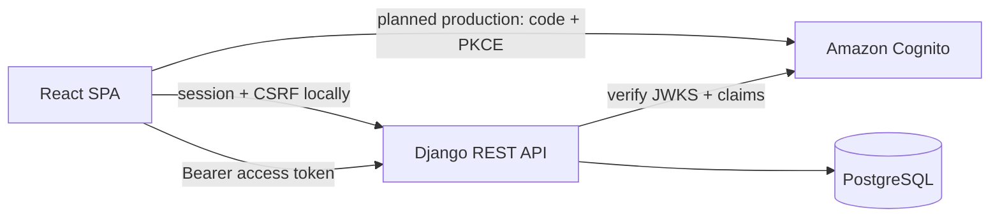

# Cloud Finance Tracker

[](https://github.com/Cooljmuno/cloud-finance-tracker/actions/workflows/ci.yml)

A security-focused, full-stack finance application built as a production-shaped software
engineering portfolio project. It uses synthetic transaction data to demonstrate authenticated
workflows, database integrity, user isolation, automated tests, and a design intended for a later
AWS deployment.

**Stack:** Python, Django REST Framework, React, TypeScript, PostgreSQL, Docker, and GitHub Actions.
AWS infrastructure and Terraform deployment are planned for a later milestone.

## Engineering highlights

- Designed a modular monolith with a React client, versioned Django REST API, and transactional
  PostgreSQL persistence.
- Enforced per-user data isolation at the queryset and serializer boundaries, returning `404` for
  cross-user identifiers to avoid leaking resource existence.
- Implemented two explicit authentication boundaries: CSRF-protected Django sessions locally and
  a production-mode Cognito OAuth 2.0/OpenID Connect integration with PKCE and verified RS256
  access tokens.
- Modeled money with signed fixed-precision decimals, UUID identifiers, ownership constraints, and
  database-level invariants.
- Gated changes with linting, type checking, migrations checks, unit and API tests, browser
  workflows, and container builds in GitHub Actions.

## Product capabilities

- Responsive authenticated transaction ledger with loading, failure, empty, and mobile states.
- Account, category, status, and date-range filters with server-side pagination.
- Transaction creation with signed decimal validation and active-resource enforcement.
- Authenticated per-user CRUD APIs for financial accounts, categories, and transactions.
- Deterministic synthetic fixtures with three accounts, ten categories, and 24 transactions.

The current automated suite contains 70 Pytest tests, 11 Vitest tests, and 2 Playwright browser
workflows. See [`docs/decisions`](docs/decisions) for the tradeoffs behind the architecture.

## Architecture



This is a modular monolith: one React client, one transactional Django backend, and one PostgreSQL
database. Django apps create domain boundaries without adding distributed-system complexity before
the product requires it.

### Authentication modes

| Environment | Browser sign-in | API authentication | Security boundary |
| --- | --- | --- | --- |
| Local | Django username/password | HttpOnly session cookie + CSRF token | Local auth routes and admin are enabled |
| Production mode (not yet deployed) | Cognito hosted UI using OAuth code + PKCE | RS256 Cognito access token | Local password routes and Django admin are not registered |

Production settings fail at startup unless the Cognito region, user-pool ID, and public app-client
ID are configured. The frontend sends the access token—not the ID token—to the API. The AWS
infrastructure that creates the user pool and hosted domain will be added in the deployment
milestone.

## Finance API

All finance routes require an authenticated user. Every queryset is scoped to `request.user`, and
cross-user identifiers return `404` rather than revealing that another user's resource exists.

| Resource | Collection | Detail |
| --- | --- | --- |
| Accounts | `/api/v1/accounts/` | `/api/v1/accounts/{uuid}/` |
| Categories | `/api/v1/categories/` | `/api/v1/categories/{uuid}/` |
| Transactions | `/api/v1/transactions/` | `/api/v1/transactions/{uuid}/` |

Transaction lists accept `account`, `category`, `status`, `date_from`, and `date_to` query
parameters. Results are paginated and sorted newest first.

Money is stored as a fixed-precision decimal. Positive transaction amounts are inflows, negative
amounts are outflows, and zero is invalid. Account balances will be derived from opening balances
and posted transactions rather than stored as a second mutable value.

## Run verification

With Docker:

```bash
docker compose exec backend pytest
docker compose exec frontend npm test
```

Without Docker:

```bash
cd backend
uv sync
uv run ruff check .
uv run ruff format --check .
uv run python manage.py makemigrations --check --dry-run
uv run pytest

cd ../frontend
npm ci
npm run lint
npm run typecheck
npm test
npm run build
npx playwright install chromium
npm run test:e2e
```

Playwright runs on the host or the Ubuntu GitHub Actions runner; the lightweight Alpine frontend
development container is used for the app build and unit tests, not as a browser-test image.

Pytest uses in-memory SQLite when PostgreSQL environment variables are absent. CI and Docker run
the same suite against PostgreSQL so database behavior is still verified using the production
database engine.

## Configuration

Local defaults live in `.env.example`; copy them to the ignored `.env` file. Never commit `.env`,
AWS credentials, tokens, passwords, or personal finance data.

Production authentication requires these backend values:

```text
COGNITO_REGION
COGNITO_USER_POOL_ID
COGNITO_APP_CLIENT_ID
```

The static frontend build requires these public values (never a client secret):

```text
VITE_AUTH_MODE=cognito
VITE_COGNITO_ISSUER
VITE_COGNITO_CLIENT_ID
VITE_COGNITO_DOMAIN
VITE_COGNITO_REDIRECT_URI
VITE_COGNITO_LOGOUT_URI
```

## Local development

Prerequisites: Docker Desktop and Git. Docker Desktop supports Apple Silicon directly; do not force
`linux/amd64`.

```bash
cp .env.example .env
docker compose up --build -d
docker compose exec backend python manage.py seed_demo_data
```

The seed command creates the fixed local username `portfolio-demo` and privately prompts for a
password. It is idempotent and uses only synthetic data. Add `--reset` to rebuild the demo user's
finance records or `--reset-password` to choose a new local password. Open
<http://localhost:5173> after seeding.

## Next milestone

Add account onboarding, then build synthetic CSV imports with preview/commit semantics, duplicate
detection, and deterministic categorization rules. Later milestones add budgets and visualizations,
then Terraform-managed AWS infrastructure, observability, and deployment workflows.

## Data policy

Use only synthetic transaction data in development, tests, screenshots, and demonstrations. Never
commit personal financial records or credentials.
