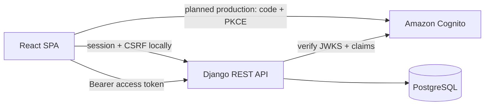

# Cloud Finance Tracker

[](https://github.com/Cooljmuno/cloud-finance-tracker/actions/workflows/ci.yml)

A security-focused, full-stack finance application built as a production-shaped software
engineering portfolio project. It uses synthetic transaction data to demonstrate authenticated
workflows, database integrity, user isolation, automated tests, and a design intended for a later
AWS deployment.

**Stack:** Python, Django REST Framework, React, TypeScript, PostgreSQL, Docker, and GitHub Actions.
AWS infrastructure and Terraform deployment are planned for a later milestone.

## Engineering highlights

- Designed a modular monolith with a React client, versioned Django REST API, and transactional
  PostgreSQL persistence.
- Enforced per-user data isolation at the queryset and serializer boundaries, returning `404` for
  cross-user detail access and rejecting foreign account/category references with `400`.
- Implemented two explicit authentication boundaries: CSRF-protected Django sessions locally and
  a production-mode Cognito OAuth 2.0/OpenID Connect integration with PKCE and verified RS256
  access tokens.
- Modeled money with signed fixed-precision decimals, UUID identifiers, ownership constraints, and
  database-level invariants.
- Built bounded CSV preview and atomic commit workflows with signed preview receipts, account
  locking, and database-enforced protection against importing the same file twice.
- Gated changes with linting, type checking, migrations checks, unit and API tests, browser
  workflows, and container builds in GitHub Actions.

## Product capabilities

- Responsive authenticated transaction ledger with loading, failure, empty, and mobile states.
- Account and category setup for authenticated users with an empty workspace, without seeded
  finance records.
- Account and category creation, editing, archiving, restoration, and confirmed deletion of unused
  resources.
- Account, category, status, and date-range filters with server-side pagination.
- Transaction creation and editing with signed decimal validation and active-resource enforcement.
- Transaction deletion with explicit confirmation and recovery when a deleted row empties a page.
- Authenticated per-user CRUD APIs for financial accounts, categories, and transactions.
- CSV preview with row and field errors, atomic import, and paginated per-user import history.
- Exact-file retry protection that preserves legitimate repeated purchases within a statement.
- Deterministic synthetic fixtures with three accounts, ten categories, and 24 transactions.

New account forms use USD. Existing account currencies are read-only in the UI; currency conversion
is not implemented. Archived resources remain visible in transaction history. An existing
transaction can keep its current archived account or category when edited; new transactions require
active resources. Deleting an account or category used by transactions returns `409` and advises
archiving it. Accounts with an import receipt also require archiving, even after their imported
transactions have been deleted.

The current automated suite contains 137 Pytest tests, 31 Vitest tests, and 2 Playwright browser
workflows. See [`docs/decisions`](docs/decisions) for the tradeoffs behind the architecture.

## Architecture



This is a modular monolith: one React client, one transactional Django backend, and one PostgreSQL
database. Django apps create domain boundaries without adding distributed-system complexity before
the product requires it.

### Authentication modes

| Environment | Browser sign-in | API authentication | Security boundary |
| --- | --- | --- | --- |
| Local | Django username/password | HttpOnly session cookie + CSRF token | Local auth routes and admin are enabled |
| Production mode (not yet deployed) | Cognito hosted UI using OAuth code + PKCE | RS256 Cognito access token | Local password routes and Django admin are not registered |

Production settings fail at startup unless the Cognito region, user-pool ID, and public app-client
ID are configured. The frontend sends the access token—not the ID token—to the API. The AWS
infrastructure that creates the user pool and hosted domain will be added in the deployment
milestone.

## Finance API

All finance routes require an authenticated user. Every queryset is scoped to `request.user`.
Accessing another user's resource returns `404`; submitting another user's account or category in
a transaction payload returns `400`.

| Resource | Collection | Detail |
| --- | --- | --- |
| Accounts | `/api/v1/accounts/` | `/api/v1/accounts/{uuid}/` |
| Categories | `/api/v1/categories/` | `/api/v1/categories/{uuid}/` |
| Transactions | `/api/v1/transactions/` | `/api/v1/transactions/{uuid}/` |
| Imports | `/api/v1/imports/` | `/api/v1/imports/{uuid}/` |

Transaction lists accept `account`, `category`, `status`, `date_from`, and `date_to` query
parameters. Results are paginated and sorted newest first.

Money is stored as a fixed-precision decimal. Positive transaction amounts are inflows, negative
amounts are outflows, and zero is invalid. Account balances will be derived from opening balances
and posted transactions rather than stored as a second mutable value.

### CSV imports

Open **Imports**, choose an active account, and upload a UTF-8 CSV file. Download the synthetic
[sample CSV](frontend/public/sample-transactions.csv) from the page or use the same file in the
repository. The file must contain these headers in this exact order:

```csv
transaction_date,description,amount,status,notes
```

| Field | Accepted input |
| --- | --- |
| `transaction_date` | A real calendar date in `YYYY-MM-DD` format |
| `description` | Required; whitespace is normalized; at most 255 characters after normalization |
| `amount` | A nonzero signed decimal with at most 12 whole digits and two decimal places; positive is an inflow and negative is an outflow |
| `status` | `posted`, `pending`, or blank to default to `posted` |
| `notes` | Optional; at most 1,000 characters |

Uploads are limited to 256 KiB and 500 nonblank records. The parser checks every record, returns up
to 20 valid rows for preview, and returns up to 50 field errors with the total error count. Any
invalid record blocks the entire import. Blank records are skipped; identical transaction records
within one file are preserved because they can represent separate purchases.

Amounts use the selected account's currency. The import does not convert between currencies.

Previewing saves no financial records. A successful preview returns a signed receipt that expires
after 15 minutes and binds the user, selected account, and SHA-256 hash of the exact uploaded bytes.
Committing uploads the file and receipt again, revalidates the records, then saves the import
receipt and all transactions in one database transaction. If any step fails, none of those records
are saved. The account row is locked while committing, and a unique account/file-hash constraint
provides the final duplicate guard.

| Endpoint | Purpose |
| --- | --- |
| `POST /api/v1/imports/preview/` | Validate the selected account and file; return a preview and signed receipt |
| `POST /api/v1/imports/commit/` | Validate the receipt and file again; atomically save the receipt and transactions |
| `GET /api/v1/imports/` | List the authenticated user's import receipts with pagination |
| `GET /api/v1/imports/{uuid}/` | Read one owned receipt; another user's receipt returns `404` |

The first commit returns `201`. A retry of the same bytes into the same account returns `200` with
the original receipt. Changing only the filename does not bypass that protection. Different bytes,
overlapping statements, and imports into another account are separate imports; this is exact-file
retry protection rather than transaction matching across statements.

Only the filename, hash, record count, account, and receipt timestamp are retained as import
metadata. Raw CSV contents are not retained after the request. Imported transactions carry a
read-only `import_batch` reference and can be edited or deleted normally. The receipt remains, so
retrying an original file does not undo edits or recreate transactions the user has deleted.
Categorization rules are a later milestone; imports initially create uncategorized transactions.

## Local development

Install Docker Desktop and Git, then start Docker Desktop. Apple Silicon is supported directly;
do not force `linux/amd64`. Local use does not require an AWS account.

From the repository root, copy the configuration on the first setup:

```bash
cp .env.example .env
```

Keep an existing `.env` when returning to the project. Start the services and wait for their
startup checks:

```bash
docker compose up --build -d --wait --wait-timeout 120
docker compose exec backend python manage.py seed_demo_data
```

The seed command privately prompts for a password and creates the local username `portfolio-demo`,
three accounts, ten categories, and 24 synthetic transactions. Sign in at
<http://localhost:5173> with that username and your chosen password.

Existing local users continue signing in with their existing credentials. The empty-workspace flow
starts after authentication: a user with no finance records can create an account and categories
through the UI. This also supports newly provisioned Cognito profiles when AWS deployment is added.
Local registration has not been added; the documented demo setup remains the simplest local start.

Check the complete local workflow:

1. Sign in and confirm that the transaction ledger loads.
2. Apply an account or category filter, then clear it.
3. Open **Accounts** and create a practice account, then edit its name. Open **Categories** and
   create a practice expense category.
4. Open **Transactions**, add `Local verification` with amount `-12.34` using those resources, then
   edit the transaction and confirm that the changes appear.
5. Try deleting its account or category and confirm that the app advises archiving instead. Archive
   both resources, then edit the existing transaction while keeping its current archived references.
6. Restore the resources. Delete the practice transaction using its confirmation, then delete the
   now-unused practice account and category using their confirmations.
7. Refresh the page, sign out, and confirm that the sign-in screen returns.

To check imports, sign in again, open **Imports**, and download the sample CSV. Preview it into an
active account and confirm its six records. Commit, confirm the receipt appears in import history,
and find the imported transactions in the ledger. Preview and commit the same file again; confirm
that the original receipt is returned and no extra transactions appear. For an error case, change
an amount to `0` in a copy of the file and confirm that preview reports the field error and prevents
commit. Use a separate practice account if you want to keep these checks apart from the seeded
fixtures; that account can be archived after importing.

The API and database health response is available at
<http://localhost:8000/api/v1/health/>.

### Returning to the project

```bash
docker compose up -d --wait --wait-timeout 120
```

Stop the services with `docker compose down`. PostgreSQL data remains in its named volume.

After pulling changes that add migrations, apply them to an already running backend:

```bash
docker compose exec backend python manage.py migrate
```

The backend startup command also runs migrations when you rebuild and restart with
`docker compose up --build -d --wait --wait-timeout 120`.

To choose a new demo password:

```bash
docker compose exec backend python manage.py changepassword portfolio-demo
```

This changes only the password. Running `seed_demo_data` again updates its fixtures without
duplicating them, which can replace edits to those synthetic fixtures. Its `--reset-password`
option also updates fixtures while changing the password; use `changepassword` when you only need
new credentials. The seed command's `--reset` option deletes all finance records belonging to the
demo user, including manually added transactions and import receipts, before recreating the
synthetic fixtures.

### Refreshing frontend dependencies

After `frontend/package-lock.json` changes, refresh the dependencies stored in the development
volume:

```bash
docker compose stop frontend
docker compose run --rm --no-deps frontend npm ci
docker compose up -d frontend
```

This leaves the PostgreSQL data volume intact.

## Run verification

With the local Docker services running, these checks do not require host installations of Python,
`uv`, or Node.js:

```bash
docker compose exec backend ruff check .
docker compose exec backend ruff format --check .
docker compose exec backend python manage.py makemigrations --check --dry-run
docker compose exec -e DJANGO_SETTINGS_MODULE=config.settings.test backend pytest
docker compose exec frontend npm run lint
docker compose exec frontend npm run typecheck
docker compose exec frontend npm test
docker compose exec frontend npm run build
```

The explicit test settings select the test authentication and database configuration instead of the
development settings inherited from `.env`.

Without Docker:

```bash
cd backend
uv sync
uv run ruff check .
uv run ruff format --check .
uv run python manage.py makemigrations --check --dry-run
uv run pytest

cd ../frontend
npm ci
npm run lint
npm run typecheck
npm test
npm run build
npx playwright install chromium
npm run test:e2e
```

Playwright runs on the host or the Ubuntu GitHub Actions runner; the lightweight Alpine frontend
development container is used for the app build and unit tests, not as a browser-test image.

The Playwright workflows mock API responses to test browser behavior. The manual local workflow
above verifies the running React client, Django API, session authentication, and PostgreSQL together.
A PostgreSQL test runs simultaneous commits of an identical file and verifies that both requests
resolve to one import receipt and one set of transactions. Other conflict-handling tests exercise
controlled interleavings. These correctness tests do not measure concurrent-load performance.

Pytest uses in-memory SQLite when PostgreSQL environment variables are absent. CI and Docker run
the same suite against PostgreSQL so database behavior is still verified using the production
database engine.

## Configuration

Local defaults live in `.env.example`; copy them to the ignored `.env` file. Never commit `.env`,
AWS credentials, tokens, passwords, or personal finance data.

Production authentication requires these backend values:

```text
COGNITO_REGION
COGNITO_USER_POOL_ID
COGNITO_APP_CLIENT_ID
```

The static frontend build requires these public values (never a client secret):

```text
VITE_AUTH_MODE=cognito
VITE_COGNITO_ISSUER
VITE_COGNITO_CLIENT_ID
VITE_COGNITO_DOMAIN
VITE_COGNITO_REDIRECT_URI
VITE_COGNITO_LOGOUT_URI
```

## Next milestone

Add ordered, explainable categorization rules with manual overrides, monthly category budgets,
and spending summaries and charts. Later milestones add Terraform-managed AWS infrastructure,
observability, and deployment workflows.

## Data policy

Use only synthetic transaction data in development, tests, screenshots, and demonstrations. Never
commit personal financial records or credentials.
